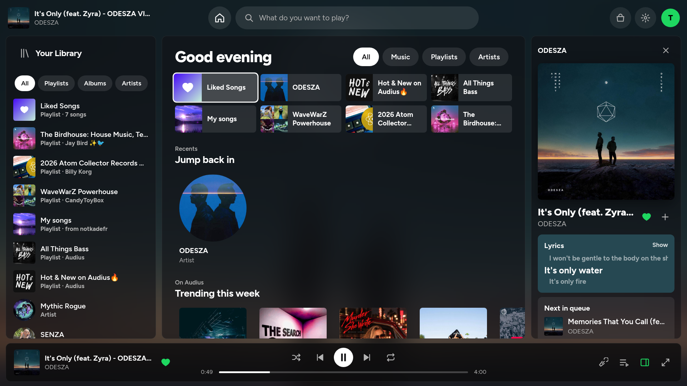
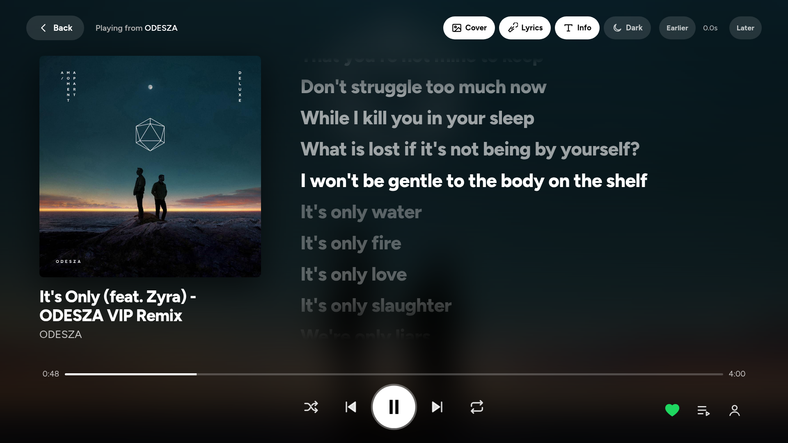

<p align="center">
  
</p>

<h1 align="center">TuneDeck</h1>

<p align="center">A fast optimized Spotify styled music player for LG webOS TVs (rooted with the Homebrew Channel)</p>

<p align="center">
  <a href="https://github.com/Eraxty/Tunedeck/releases"></a>
  <a href="https://github.com/Eraxty/Tunedeck/releases/latest"></a>
  
  <a href="https://github.com/webosbrew/webos-homebrew-channel"></a>
  
  <a href="LICENSE"></a>
</p>

I made this because the official Spotify TV was very laggy and extremely unoptimised. This is a better client
for Spotify and includes many features such as a marketplace for themes and extensions.





- **Spotify**: plays your Spotify music, playlists and Liked Songs through Spotify's official Web Playback
  SDK (requires Spotify Premium). Your TV will show as TuneDeck TV in Spotify Connect.
- **Without Spotify**: free music from [Audius](https://audius.co), plus importing your Spotify or YouTube
  library from a data export but I wouldn't recommend the free music
- Synced lyrics from [LRCLIB](https://lrclib.net); themes and extensions from the Spicetify community.

TuneDeck is free and non-commercial as Spotify's terms prohibit the use of the player for commercial purposes
and I love OSS

## Features

### Look like Spotify desktop

- Home with your quick picks like spotify desktop app which shows your top songs, your playlists, favourite
  artists and new releases
- Now Playing panel on the right showing the cover, live lyrics, next in queue and information
- Album art background that blurs and changes with every track sounds awesome

### Fullscreen player

- You can disable/enable cover, lyrics, and info in fullscreen player plus a dark mode
- Lyrics sync
- If the lyrics are a little bit early or late (unsynchronized), you can adjust that

### Playbacks

- Your TV will appear as TuneDeck TV in Spotify Connect, so you can control it even from your phone
- Queue page where you can jump to any track
- Shuffle and repeat as it works in Spotify
- Like songs and add them to your playlist from the player

### Designed for the remote

- Easy navigation
- Magic Remote pointer and scroll wheel support
- Media keys support: yellow - lyrics, blue - player, red/green - lyrics synchronization
- Designed for the TV's weak hardware. Minimalistic but beautiful

### Marketplace

- Color themes from Spicetify community, saved for the current profile
- Spicetify extensions converted on the fly for the TV to run in its old browser. Extension compatibility
  will be shown

## Installation

An LG TV rooted with the [Homebrew Channel](https://github.com/webosbrew/webos-homebrew-channel) for Spotify
is needed since the Spotify sign-in requires a small helper process to be run on the TV as root. On the TV
with only Developer Mode the application installs correctly and free music works, however, sign-in via
Spotify does not.

### From the Homebrew Channel

Go to the Homebrew Channel, choose TuneDeck and click Install. (It is not available just yet,
awaiting approval. In the meantime, you may use one of the methods below.)

### Manual ipk installation

Download `com.ice.tunedeck_<version>_all.ipk` from the
[latest release](https://github.com/Eraxty/Tunedeck/releases/latest), and select one of the options below.

- **webOS Dev Manager** (Windows, macOS, Linux): download it from
  [webosbrew/dev-manager-desktop](https://github.com/webosbrew/dev-manager-desktop), add your TV, and install
  the ipk using the Apps tab.
- **ares-cli** on your computer: configure your TV one-time using `ares-setup-device`, and then run
  `ares-install com.ice.tunedeck_<version>_all.ipk`.
- **Rooted TV SSH access**:

  ```bash
  scp com.ice.tunedeck_*_all.ipk root@<tv-ip>:/tmp/tunedeck.ipk
  ssh root@<tv-ip> "luna-send -i luna://com.webos.appInstallService/dev/install '{\"id\":\"com.ice.tunedeck\",\"ipkUrl\":\"/tmp/tunedeck.ipk\",\"subscribe\":true}'"
  ```

Regardless of how you installed it, run TuneDeck once: on a rooted TV it installs its helper automatically
via the Homebrew Channel and no additional steps are needed.

### Development

Rooted SSH and `ares-cli` on your computer:

```bash
TV_HOST=root@<tv-ip> ./scripts/deploy.sh
./scripts/release.sh
```

## Spotify sign-in

To let the app sign in to Spotify, it has to have a unique key ("Client ID"), that was generated individually
by the listener who uses it. Thus, every listener has to set up their own key once. It takes about 2 minutes
and requires Spotify Premium.

1. On the TV screen: First launch Sign in with Spotify (later: Settings → Sign in with Spotify or
   Add profile → Sign in with Spotify).

2. Make sure your phone is connected to the same Wi-Fi as your TV and scan the QR code.

3. On the phone:
   1. Sign in to the Spotify developer dashboard with *your* Spotify account.
   2. Create an application called TuneDeck.
   3. Add the Redirect URI, as shown on the phone screen (copy button), e.g.,
      `https://192.168.1.3:8900/callback`.
   4. Select Web API and Web Playback SDK, agree, and Save.
   5. Copy your application's Client ID into the phone screen and click on Send to TV.

4. Click Log in with Spotify. Your phone will warn you that the connection isn't secure; click on
   Advanced, then Continue. This is the certificate of your TV which is used only to complete the
   login process.

5. Log in to Spotify and click on Agree. Then the TV will log in by itself.

The TV will remember your key for your profile and will skip the login process during the following launches.
Only the Client ID gets sent to the TV. Never disclose Client ID of your TV to anyone and never share your
Client secret. Reserve your TV IP address within your router to make sure the redirect address works.

## Usage instructions

It is built keeping in mind the concept of desktop client of spotify and comes with same UI. You can browse
the app using your lg remote just like you do with other apps on the TV.

## Troubleshooting

- **“Site can't be reached” on the phone**: the phone isn’t on the same WiFi network as the TV (mobile data
  or guest network) or the router segregates devices, Instead use a computer connected to the same WiFi.

- **“INVALID_CLIENT: Invalid redirect URI” / “redirect_uri not matching configuration”**: the Redirect URI is
  not configured in the Spotify app you are using. Add the redirect URI exactly as described and press Save.

- **“This Spotify account isn't on the app's allowed users list”**: you are trying to login using another
  Spotify account than the one used to create the key. Either use the same account or add another Spotify
  account as an additional user in the “Users and access” section of the dashboard.

- **Marketplace Extensions**: Extensions that are present on marketplace are made for Spotify Desktop, using
  the modern browser engine. TuneDeck makes sure that it works with TV's system when opened (through
  [Babel](https://babeljs.io), which is part of it), and lets you know whether it works fully or partially
  because of its dependency on parts of Spotify desktop user interface which TuneDeck doesn't have.

- **Logs**: it logs into `/tmp/tunedeck-app.log` on the TV (`ssh root@<tv-ip> cat /tmp/tunedeck-app.log`).

## Restrictions by Spotify (developer apps, 2026)

- No music videos or Canvas loops
- No automix playlists
- No crossfade overlap or 8D for Spotify songs: Spotify's player for other apps plays one stream at a time
  and its audio can't be processed by the app
